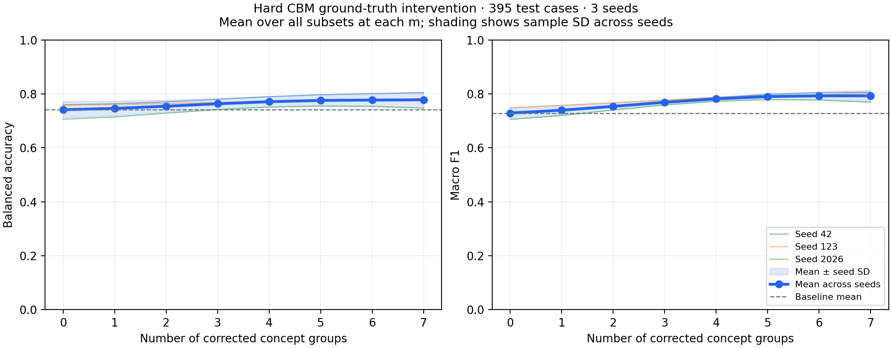

# Kết quả concept intervention của Hard CBM

Seeds: [42, 123, 2026]; 395 ca test; 128 subsets cho mỗi seed.

Thay toàn bộ group được sửa bằng ground-truth one-hot. Giữ nguyên các groups chưa sửa, diagnosis head và threshold validation của từng seed; không huấn luyện lại.

Metrics được tính riêng cho mỗi subset trên toàn bộ test, rồi lấy trung bình theo m, sau đó tổng hợp mean ± sample SD giữa seeds. SD này không phải khoảng tin cậy theo mẫu.

| Số groups sửa | Balanced Accuracy (%) | Macro-F1 | Ca tốt lên (TB) | Ca xấu đi (TB) |
|---|---:|---:|---:|---:|
| 0 | 74.11 ± 3.07 | 0.7285 ± 0.0216 | 0.00 | 0.00 |
| 1 | 74.60 ± 2.77 | 0.7393 ± 0.0188 | 9.76 | 4.52 |
| 2 | 75.41 ± 2.27 | 0.7535 ± 0.0133 | 19.70 | 8.37 |
| 3 | 76.31 ± 1.97 | 0.7686 ± 0.0090 | 29.36 | 11.90 |
| 4 | 77.09 ± 1.94 | 0.7815 ± 0.0079 | 38.04 | 15.51 |
| 5 | 77.56 ± 2.09 | 0.7898 ± 0.0102 | 45.21 | 19.44 |
| 6 | 77.70 ± 2.37 | 0.7926 ± 0.0143 | 50.62 | 23.71 |
| 7 | 77.78 ± 2.90 | 0.7925 ± 0.0206 | 54.67 | 28.00 |

Ca tốt lên/xấu đi được so với m=0 của cùng seed; ở m=1…6 là trung bình qua subsets và seeds, không phải số ca duy nhất. Ở m=7, mỗi seed có một subset sửa đủ bảy groups.

| Sửa toàn bộ 7 groups | Balanced Accuracy (%) | Macro-F1 | Tốt lên | Xấu đi |
|---|---:|---:|---:|---:|
| Seed 42 | 80.39 | 0.8058 | 58 | 28 |
| Seed 123 | 78.30 | 0.8029 | 52 | 28 |
| Seed 2026 | 74.66 | 0.7688 | 54 | 28 |

Sửa đủ bảy groups làm Balanced Accuracy trung bình thay đổi +3.67 điểm phần trăm (74.11% → 77.78%). Đây là kết quả mô tả trên các checkpoints hiện có.

Diagnosis head Hard CBM được học từ predicted one-hot concepts và nhận ground-truth one-hot khi intervention. Hai đầu vào cùng dạng rời rạc, nhưng phân bố tổ hợp concept dự đoán và concept GT vẫn có thể khác nhau. Cùng representation không bảo đảm hiệu chỉnh có lợi. Kết quả chưa tự xác lập nguyên nhân của chênh lệch Soft CBM–Hard CBM, ảnh hưởng của inconsistency hoặc ưu thế của ECBM.

Các file đi kèm: `summary.json`, `curve.csv`, `per_concept.csv`, `full_intervention_cases.csv` và JSON chi tiết cho từng seed.

`per_concept.csv` đo tác động sửa riêng từng group, không đo tầm quan trọng tổng quát hoặc quan hệ nhân quả. Với Hard CBM, groups chưa sửa giữ nguyên dự đoán nên accuracy của chúng không thay đổi khi giữ cùng group. Trung bình qua các group còn lại có thể thay đổi theo subset; tại m=7 chỉ số này không áp dụng.

Đây là mô phỏng hiệu chỉnh annotation. Kết quả sửa toàn bộ concepts dùng diagnosis head Hard CBM đã học và không đồng nhất với Oracle LR được huấn luyện riêng.
