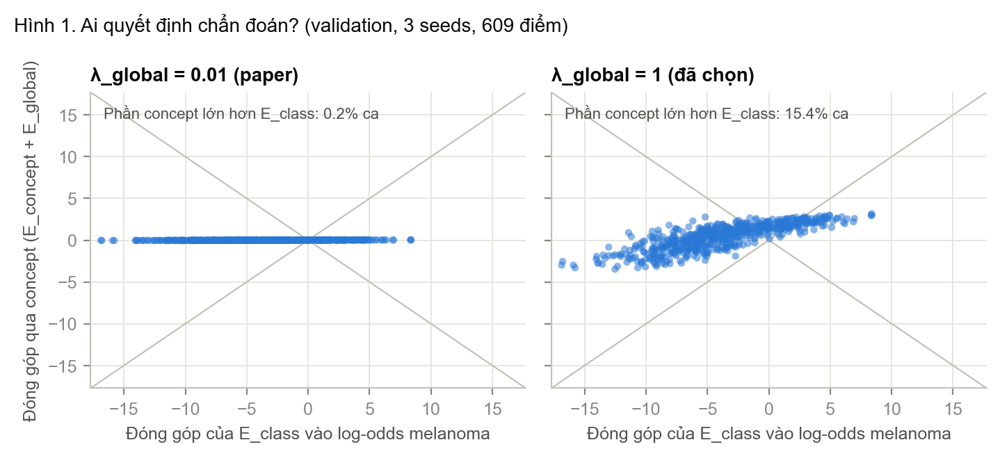
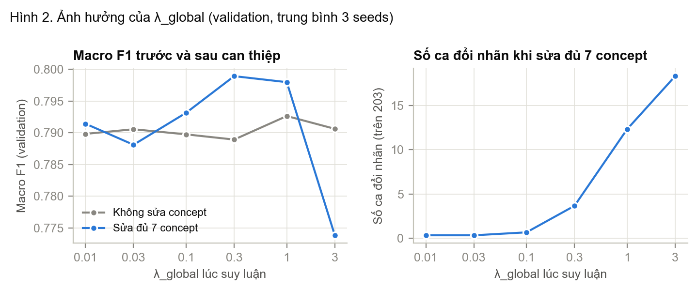
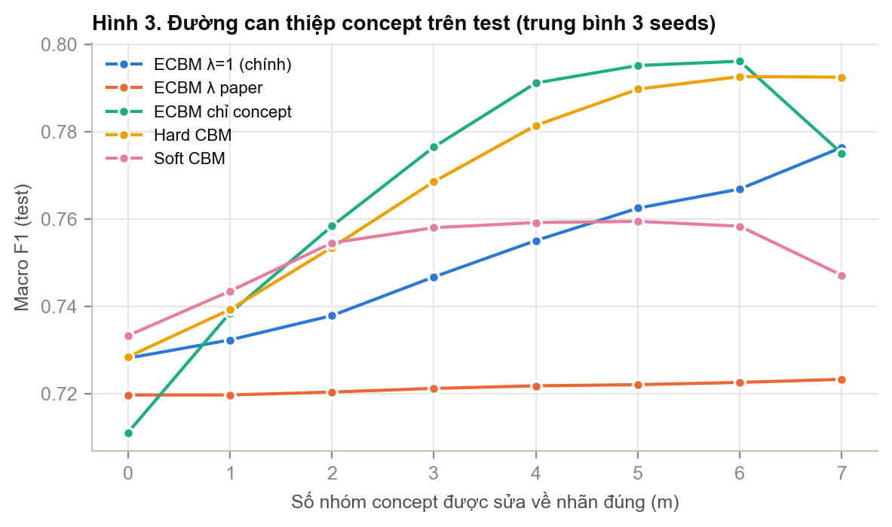
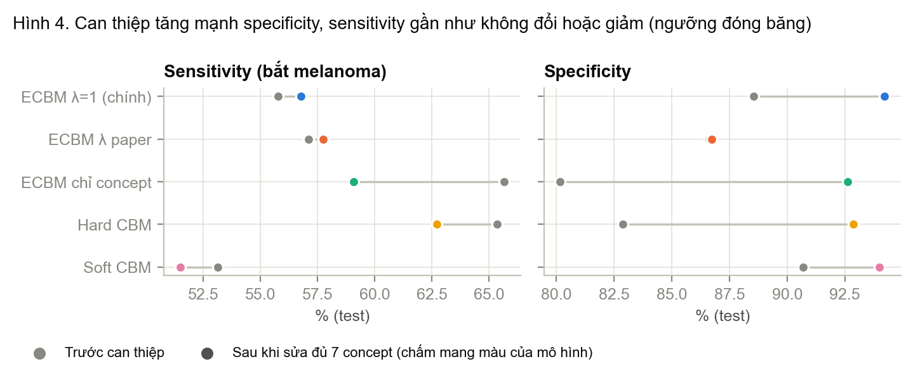
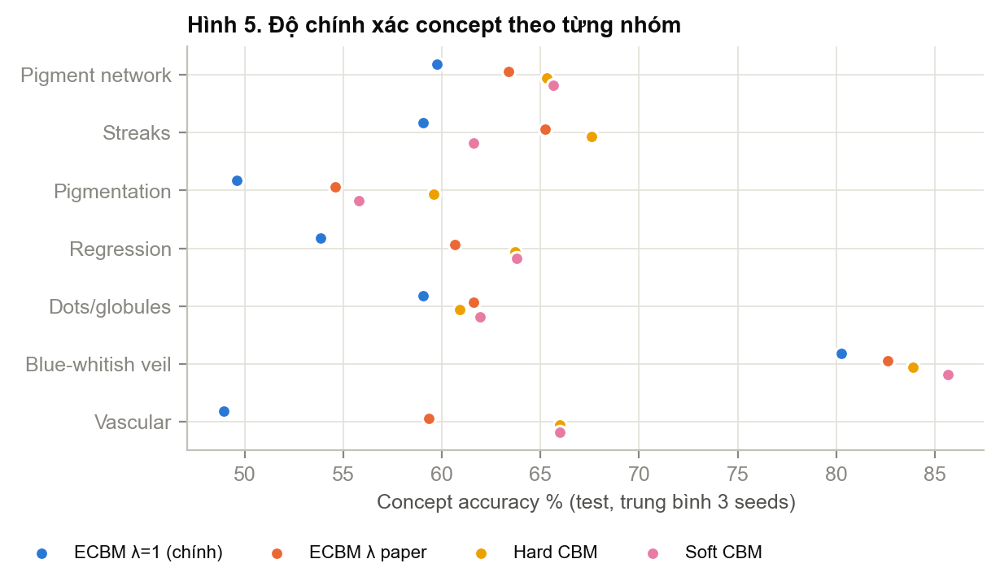
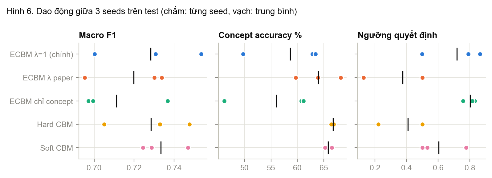
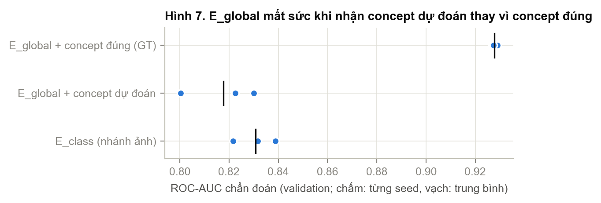

# Báo cáo tổng kết: quy trình chung trên Derm7pt

Cập nhật ngày 02/11/2026. Mọi số liệu được đọc lại từ kết quả đã lưu; báo cáo này không chạy thêm lần chấm test nào.

## 1. Những gì đã làm được

1. **Huấn luyện 4 mô hình theo cùng một quy trình:** Black-box, Soft CBM, Hard CBM và ECBM.
   - Cùng EfficientNet-B0, 50 epoch, AdamW, 3 seed (42/123/2026).
   - Checkpoint chọn theo validation Macro F1@0.5; ngưỡng chọn trên validation rồi giữ cố định cho test.
2. **Chọn λ_global cho ECBM trên validation** theo luật ghi trước: chọn λ=1, thay cho λ=0.01 của paper. Xem [kế hoạch](ecbm/lambda_global_study/study_plan.json) và [báo cáo](ecbm/lambda_global_study/report.md).
3. **Khóa kế hoạch rồi chấm test đúng một lần.** Checkpoint được khóa bằng SHA-256, kế hoạch test ghi trước trong [`test_plan.json`](test_plan.json).
4. **Đánh giá can thiệp concept:** sửa từ 0 đến 7 nhóm concept bằng nhãn thật, duyệt đủ 128 tập con, cho cả CBM và ECBM. So sánh bằng paired bootstrap 2000 lần.
5. **Phân tích hạn chế của ECBM:** 6 hạn chế, 7 hình (mục 5).

## 2. Số liệu test

Test gồm 395 ca, trong đó 101 melanoma. Các giá trị là mean ± SD qua 3 seed.

Ký hiệu ECBM theo trọng số năng lượng lúc suy luận (E_class/E_concept/E_global): **λ=1** là 1/1/1 (mô hình chính); **λ paper** là 1/1/0.01; **chỉ concept** là 0/1/1, chỉ để đối chiếu.

### 2.1. Bảng chính

| Mô hình | Acc % | BAcc % | Macro F1 | ROC-AUC | Concept acc % |
|---|---:|---:|---:|---:|---:|
| Black-box | 80.84 ± 0.15 | 73.92 ± 2.25 | **0.7428** ± 0.0119 | 0.8433 ± 0.0071 | — |
| Soft CBM | **81.10** ± 0.58 | 71.92 ± 1.37 | 0.7333 ± 0.0119 | **0.8674** ± 0.0058 | 65.77 ± 0.67 |
| Hard CBM | 78.40 ± 1.39 | **74.11** ± 3.07 | 0.7285 ± 0.0216 | 0.8394 ± 0.0201 | **66.71** ± 0.27 |
| **ECBM λ=1 (chính)** | 80.17 ± 1.02 | 72.16 ± 3.70 | 0.7282 ± 0.0267 | 0.8535 ± 0.0170 | 58.65 ± 7.76 |
| ECBM λ paper (0.01) | 79.07 ± 1.92 | 71.86 ± 3.40 | 0.7198 ± 0.0212 | 0.8479 ± 0.0129 | 63.92 ± 4.23 |
| ECBM chỉ concept (phụ) | 76.46 ± 3.78 | 72.92 ± 1.21 | 0.7111 ± 0.0222 | 0.8329 ± 0.0225 | 56.02 ± 8.55 |

Các metric khác (sensitivity, specificity, concept F1...) nằm trong file kết quả của từng mô hình (mục 7), dùng cho phụ lục nếu cần.

### 2.2. Paired bootstrap Macro F1

2000 lần lặp, seed 20261005.

| So sánh | Chênh lệch | Khoảng 95% | Chứa 0 |
|---|---:|---:|:---:|
| ECBM λ=1 − Black-box | −0.0146 | [−0.0432, +0.0139] | có |
| ECBM λ=1 − Soft CBM | −0.0051 | [−0.0359, +0.0249] | có |
| ECBM λ=1 − Hard CBM | −0.0003 | [−0.0308, +0.0293] | có |
| ECBM chỉ concept − Soft CBM | −0.0222 | [−0.0579, +0.0160] | có |
| ECBM chỉ concept − Hard CBM | −0.0174 | [−0.0483, +0.0145] | có |

Mọi khoảng đều chứa 0, nên không có khác biệt có ý nghĩa thống kê.

### 2.3. Can thiệp concept

Macro F1 khi sửa concept bằng nhãn thật, ngưỡng giữ cố định.

| Mô hình | Không sửa | Sửa đủ 7 nhóm | Tăng | Curve AUC | Số ca đổi nhãn |
|---|---:|---:|---:|---:|---:|
| Soft CBM | 0.7333 | 0.7472 | +0.014 | 0.7534 | 68.7 |
| **Hard CBM** | 0.7285 | **0.7925** | **+0.064** | 0.7694 | 82.7 |
| ECBM λ=1 | 0.7282 | 0.7764 | +0.048 | 0.7506 | 24.3 |
| ECBM λ paper | 0.7198 | 0.7233 | +0.004 | 0.7214 | 1.0 |
| ECBM chỉ concept | 0.7111 | 0.7751 | +0.064 | **0.7713** | 91.3 |

"Số ca đổi nhãn" là số ca trung bình (trên 395) đổi nhãn khi sửa đủ 7 nhóm.

Tỷ lệ ca mà ECBM cho cùng nhãn với riêng nhánh ảnh E_class:
- λ=1: 96.96%
- λ paper: 99.92%
- chỉ concept: 80.59%

## 3. Ưu điểm

- **Phương pháp chặt chẽ.** Các mô hình được so sánh công bằng, mọi lựa chọn làm trên validation, kế hoạch ghi trước và test chỉ chấm một lần. Đây là điểm mạnh nhất hiện tại.
- **ECBM chẩn đoán ngang black-box.** Macro F1 chỉ chênh −0.015 và không có ý nghĩa thống kê. ROC-AUC 0.854 nhỉnh hơn black-box 0.843, nhưng chênh lệch này chưa được kiểm định.
- **Phát hiện mới về cấu hình của paper.** Với λ của paper, nhánh concept gần như không có tác dụng: sửa đủ 7 concept chỉ đổi nhãn trung bình 1 trên 395 ca. λ=1 (chọn trên validation) làm can thiệp có tác dụng: +0.048 so với +0.004.
- **Suy luận chính xác.** Mô hình liệt kê đủ 8,640 tổ hợp concept, không xấp xỉ.
- **Giải thích được bằng số.** Phân rã log-odds cho biết ở từng ca, bao nhiêu phần quyết định đến từ concept.

## 4. Hạn chế

### 4.1. Về kết quả

- **ECBM không thắng mô hình nào.** Mỗi metric có một mô hình khác đứng đầu, và không khác biệt nào có ý nghĩa thống kê.
- **Về can thiệp, Hard CBM tốt hơn ECBM λ=1:** 0.7925 so với 0.7764 khi sửa đủ, curve AUC 0.7694 so với 0.7506. Nghĩa là ECBM λ=1 chỉ can thiệp tốt hơn ECBM λ paper, chứ không tốt hơn CBM.
- **Concept của ECBM thấp nhất:** 58.65%, so với 65.77–66.71% của CBM. Tăng λ còn làm concept kém thêm (63.92 → 58.65).
- **Chẩn đoán vẫn chủ yếu do nhánh ảnh:** 97% ca trùng nhãn với E_class.
- **Dao động giữa các seed lớn.** Macro F1 của ECBM λ=1 đi từ 0.700 (seed 123) đến 0.754 (seed 42); concept accuracy có SD 7.8 điểm.
- **Sensitivity thấp ở mọi mô hình (53–66%).** Tức là bỏ sót khoảng một phần ba đến gần một nửa ca melanoma. Metric này không có trong bảng chính nhưng nên bàn trong phần thảo luận.

Nguyên nhân của các hạn chế phía ECBM được phân tích ở mục 5.

### 4.2. Về thực nghiệm

- Chỉ có 3 seed và 395 ca test, nên khoảng tin cậy rộng khoảng ±0.03 Macro F1 và khó phát hiện khác biệt nhỏ.
- Bootstrap mới làm cho Macro F1, và chỉ cho các cặp có ECBM.
- Test đã bị xem. Mọi cải tiến sau này phải chọn hết trên validation, ghi kế hoạch trước, và ghi rõ là "đánh giá trên test đã thấy".
- Chỉ dùng một dataset (Derm7pt) và một backbone.
- Hướng guard (repo `ECBM_Derm7pt`) không cải thiện, được ghi lại như một kết quả âm (mục 5.7).

## 5. Phân tích hạn chế của ECBM

Phạm vi: ECBM categorical, cohort quy trình chung 50 epochs (`ecbm/efficientnet_b0_unified_exact_e50`), 3 seeds 42/123/2026.

- Số liệu **validation** (203 ca) được tính mới từ các checkpoint đã đóng băng.
- Số liệu **test** (395 ca) chỉ đọc lại từ kết quả đã lưu (`ecbm/test_modes/`, thư mục `intervention/` của hai cohort CBM), không đọc lại ảnh test.
- Tái tạo số liệu và hình: `python3 experiments/analyze_ecbm_limitations.py`. Số liệu đầy đủ trong [`numbers.json`](ecbm/limitations/numbers.json); hình nằm trong `ecbm/limitations/` (PNG và SVG).

### Tóm tắt

| # | Hạn chế | Số liệu chính | Hình |
|---|---|---|---|
| 5.1 | Chẩn đoán tự động gần như chỉ dựa vào nhánh ảnh E_class | Với λ=1, độ lớn đóng góp vào log-odds: E_class 4.92, phần qua concept 1.35. Phần concept lớn hơn E_class ở 15.4% ca. Test: trùng nhãn với E_class 97.0% | 1 |
| 5.2 | Với λ của paper, can thiệp concept vô tác dụng | Test: sửa đủ 7 concept chỉ tăng Macro F1 +0.004 (λ paper), so với +0.048 (λ=1) | 2, 3 |
| 5.3 | Can thiệp làm lệch điểm hoạt động | Test, λ=1: specificity 88.5% → 94.2%, sensitivity 55.8% → 56.8%; ROC-AUC 0.853 → 0.918 | 4 |
| 5.4 | Concept dự đoán kém hơn CBM, và tăng λ_global làm concept kém thêm | Test concept accuracy: λ=1 58.7%, λ paper 63.9%, Hard CBM 66.7%, Soft CBM 65.8% | 5 |
| 5.5 | Không ổn định giữa các seed | Test concept accuracy với λ=1: 62.8 / 49.7 / 63.4%. Hard CBM: 66.9 / 66.8 / 66.4% | 6 |
| 5.6 | E_global được train trên concept gần đúng nhưng lúc chạy nhận concept sai nhiều | Validation ROC-AUC: E_global + concept đúng 0.928, E_global + concept dự đoán 0.818, E_class 0.831. Nhiễu lúc train 7.1%, lỗi concept dự đoán 36.7% | 7 |

Phát hiện quan trọng nhất là chuỗi nhân quả 5.6 → 5.1: nhánh concept yếu khi nhận concept dự đoán, nên chẩn đoán dựa vào E_class.

### 5.1. Chẩn đoán tự động gần như chỉ dựa vào E_class

**Hiện tượng.** Với suy luận chính xác, log-odds melanoma tách đúng thành hai phần:

log p(y=1|x)/p(y=0|x) = [E_class(x,0) − E_class(x,1)] + [phần đi qua concept: E_concept + E_global]

Hình 1 vẽ hai phần này cho 609 điểm (203 ca × 3 seeds). Điểm nằm giữa hai đường chéo là ca mà phần concept lớn hơn E_class.

**Bằng chứng (validation, trung bình 3 seeds).**

| | λ paper (0.01) | λ = 1 |
|---|---:|---:|
| Độ lớn trung bình phần E_class | 4.92 | 4.92 |
| Độ lớn trung bình phần qua concept | 0.016 | 1.35 |
| Tỷ lệ ca phần concept lớn hơn E_class | 0.2% | 15.4% |
| Tỷ lệ ca hai phần ngược chiều nhau | 19.1% | 41.1% |
| Trong các ca ngược chiều, concept thắng | 0% | 15.3% |

Trên test, chẩn đoán trùng nhãn với riêng E_class: λ paper 99.9%, λ=1 97.0%, chỉ concept 80.6%.

**Nguyên nhân.**
- E_class được train với trọng số 3, các năng lượng khác trọng số 1. Log-odds trung bình 4.9 tương ứng xác suất khoảng 0.99, tức nhánh ảnh rất "tự tin".
- E_global không nhìn ảnh, nên backbone chỉ học từ E_class và E_concept.
- Nhánh concept yếu hơn E_class khi nhận concept dự đoán (mục 5.6). Mô hình dựa vào E_class là hợp lý về mặt độ chính xác.

**Hệ quả.** Ở chế độ tự động, concept chỉ là lời giải thích đi kèm, không phải lý do của chẩn đoán. Không được viết "ECBM chẩn đoán dựa trên concept" cho chế độ này.

**Hướng cải tiến.** Giảm trọng số E_class khi train (3 → 1), đồng thời sửa mục 5.6 để nhánh concept đủ mạnh.

### 5.2. Với λ của paper, can thiệp concept vô tác dụng

**Hiện tượng.** Với λ_global = 0.01 như paper, sửa concept gần như không làm đổi nhãn nào.

**Bằng chứng.**
- Validation (Hình 2): số ca đổi nhãn khi sửa đủ 7 concept tăng từ 0.3 (λ=0.01) lên 12.3 (λ=1) và 18.3 (λ=3).
- Validation: Macro F1 sau can thiệp cao nhất ở λ 0.3–1. Đến λ=3 thì giảm xuống 0.774, thấp hơn cả khi không sửa (0.791).
- Test (Hình 3): mức tăng Macro F1 khi sửa đủ 7 concept là +0.004 với λ paper và +0.048 với λ=1 (bảng ở mục 2.3).

**Nguyên nhân.** Ở λ=0.01, phần đi qua concept chỉ khoảng 0.016 log-odds (mục 5.1), quá nhỏ để đổi quyết định. Ở λ=3 thì ngược lại: E_global lấn át và xác suất dồn sát 0 hoặc 1 (ngưỡng chọn trên validation lên tới ~0.99).

**Hệ quả.** λ_global là siêu tham số nhạy và không mang nguyên từ CUB sang Derm7pt được. Dùng nguyên giá trị của paper thì mất luôn tính năng can thiệp, vốn là điểm mạnh chính của ECBM.

**Hướng cải tiến.** Chọn λ theo dữ liệu, như study đã làm, hoặc cho mô hình học λ.

### 5.3. Can thiệp làm lệch điểm hoạt động

**Hiện tượng.** Sau khi sửa concept, mô hình bớt báo động giả, nhưng không bắt được thêm melanoma.

**Bằng chứng (test, ngưỡng đóng băng).**

| Mô hình | Sensitivity trước → sau | Specificity trước → sau | ROC-AUC trước → sau |
|---|---|---|---|
| ECBM λ=1 | 55.8 → 56.8% | 88.5 → 94.2% | 0.853 → 0.918 |
| ECBM chỉ concept | 65.7 → 59.1% | 80.2 → 92.6% | 0.833 → 0.924 |
| Hard CBM | 65.3 → 62.7% | 82.9 → 92.9% | 0.839 → 0.921 |

Với ECBM λ=1 và chỉ concept, khoảng 50% ca melanoma bị **giảm** xác suất melanoma sau khi sửa đủ 7 concept.

**Nguyên nhân.**
- Ngưỡng được chọn trên phân bố xác suất khi concept là dự đoán. Concept đúng làm phân bố đó dịch chuyển, nên ngưỡng cũ không còn hợp. AUC tăng mạnh chứng tỏ khả năng xếp hạng tốt lên; chỉ có ngưỡng là lệch.
- Derm7pt có 30.3% số ca thuộc các bộ concept giống nhau nhưng khác chẩn đoán (Nápoles et al., 2026). Với một phần ca melanoma, bộ concept đúng trông giống ca lành tính.

**Hệ quả.** Hạn chế này không riêng ECBM, Hard CBM cũng bị. Nhưng nó làm F1 sau can thiệp đánh giá thấp lợi ích thật của việc sửa concept.

**Hướng cải tiến.** Chọn ngưỡng hoặc hiệu chỉnh xác suất riêng cho chế độ "đã sửa concept". Luôn báo cáo AUC kèm F1.

### 5.4. Concept kém hơn CBM, và tăng λ_global làm concept kém thêm

**Hiện tượng.** Concept mà ECBM hiển thị cho bác sĩ đúng ít hơn concept của CBM, và càng kém hơn khi concept được phép ảnh hưởng chẩn đoán.

**Bằng chứng.**
- Test, concept accuracy: λ=1 58.7%, λ paper 63.9%, chỉ concept 56.0%, Hard CBM 66.7%, Soft CBM 65.8%.
- Validation, cùng checkpoint, chỉ đổi cách suy luận: E_concept riêng 63.3%, λ paper 63.4%, λ=1 58.6%, chỉ concept 56.2%.
- Giảm mạnh nhất ở Vascular (test: 59.3% với λ paper, 48.9% với λ=1, 66.0% với CBM) và Pigmentation (54.6%, 49.6%, 59.6% với Hard CBM).

**Nguyên nhân.**
- E_concept dùng chung một phép chiếu 32 chiều cho cả 7 nhóm. CBM dùng head riêng lấy thẳng từ 1280 chiều. Mức E_concept riêng (63.3%) đã thấp hơn CBM.
- Khi λ_global lớn, suy luận chính xác kéo xác suất concept về các bộ concept "hợp" với chẩn đoán. Chẩn đoán vì thế bóp méo ngược lại lời giải thích.

**Hệ quả.** Có một đánh đổi: để concept ảnh hưởng chẩn đoán (mục 5.2), mô hình chấp nhận để chẩn đoán làm sai lệch concept được hiển thị.

**Hướng cải tiến.** Tăng sức chứa của E_concept (chiều ẩn lớn hơn, phép chiếu riêng cho từng nhóm). Hoặc hiển thị concept từ E_concept trước bước suy luận chung.

### 5.5. Không ổn định giữa các seed

**Bằng chứng.**
- Test, ECBM λ=1: concept accuracy 62.8 / 49.7 / 63.4%, ngưỡng 0.499 / 0.865 / 0.790.
- Hard CBM: concept accuracy 66.9 / 66.8 / 66.4%.

**Nguyên nhân (gợi ý, mới có 3 seeds).** Checkpoint được chọn theo Macro F1 chẩn đoán, mà chẩn đoán do E_class chi phối (mục 5.1). Vì vậy có thể chọn trúng epoch mà nhánh concept chưa học xong.

| Seed | Best epoch | E_concept accuracy (validation) | λ=1 (validation) |
|---|---:|---:|---:|
| 123 | 10 | 59.8% | 50.9% |
| 42 | 17 | 63.0% | 60.8% |
| 2026 | 30 | 67.2% | 64.0% |

λ=1 khuếch đại điểm yếu này: ở seed 123, concept accuracy tụt 9 điểm.

**Hướng cải tiến.** Chọn checkpoint theo tiêu chí kết hợp chẩn đoán và concept, hoặc đặt số epoch tối thiểu.

### 5.6. E_global: train trên concept gần đúng, chạy trên concept sai nhiều

**Hiện tượng.** Nhánh concept → chẩn đoán rất mạnh khi nhận concept đúng, nhưng yếu hơn cả E_class khi nhận concept dự đoán.

**Bằng chứng (validation, trung bình 3 seeds).**

| Đầu vào | ROC-AUC | Macro F1 (ngưỡng chọn trên validation) |
|---|---:|---:|
| E_global + concept đúng (GT) | 0.928 | 0.849 |
| E_global + concept dự đoán (argmax E_concept) | 0.818 | 0.762 |
| E_class (nhánh ảnh) | 0.831 | 0.790 |

**Nguyên nhân.** Khi train, E_global nhận concept đúng có xáo trộn: 20% ca × 2/7 nhóm mỗi batch, tức **7.1%** ô concept bị sai. Lúc chạy, concept dự đoán sai **36.7%**, gấp khoảng 5 lần. E_global chưa từng học cách xử lý mức nhiễu đó.

**Hệ quả.** Đây là gốc của mục 5.1: nhánh concept yếu hơn nhánh ảnh khi chạy thật, nên mô hình dựa vào E_class.

**Hướng cải tiến.** Train E_global trên concept giống lúc chạy: concept dự đoán, lấy mẫu từ phân bố E_concept, hoặc xáo trộn với tỷ lệ khoảng 35%.

### 5.7. Hướng đã thử nhưng không cải thiện: `ecbm_guard`

`ecbm_guard` (repo `ECBM_Derm7pt`) thêm ngân sách KL cho việc sửa concept lúc suy luận. Kết quả không cải thiện; pilot ghi trong README của repo đó cho thấy accuracy chẩn đoán giữ nguyên 80,79%.

Nhìn từ các phân tích trên, guard can thiệp vào bước tối ưu concept lúc suy luận, chưa nhắm vào mục 5.1 và 5.6. Đây có thể là lý do không cải thiện, nhưng chưa được kiểm chứng.

### 5.8. Giới hạn của phân tích

- Ngoài các giới hạn ở mục 4.2: validation chỉ có 203 ca và đã được dùng để chọn checkpoint, ngưỡng và λ.
- Sensitivity và specificity chỉ dùng ở mục 5.3 để giải thích hạn chế. Bảng kết quả chính vẫn dùng 5 metric đã chốt.

## 6. Ý nghĩa cho khóa luận

Với kết quả hiện tại, đóng góp của khóa luận là ba ý: đánh giá công bằng, chỉ ra ECBM theo paper không dùng tới concept, và phân tích vì sao. Chưa thể nói "ECBM tốt hơn".

Mục tiêu hợp lý cho bước cải tiến có hai phần, đều phải giữ được hiệu năng chẩn đoán:
- can thiệp ít nhất bằng Hard CBM;
- concept accuracy không thấp hơn CBM.

Thứ tự cải tiến gợi ý:

1. **Mục 5.6 cùng 5.1:** train E_global trên concept giống lúc chạy, và giảm trọng số E_class. Đây là gốc của việc concept không quyết định chẩn đoán.
2. **Mục 5.4 và 5.5:** tăng sức chứa E_concept, chọn checkpoint có tính tới concept.
3. **Mục 5.3:** ngưỡng riêng cho chế độ can thiệp. Việc này rẻ, không cần train lại.

## 7. Nguồn số liệu

| Nội dung | File |
|---|---|
| Kết quả test Black-box, Soft CBM, Hard CBM | `efficientnet_b0/linear_e50_headlr0.001/`, `soft_cbm/efficientnet_b0_mlp128_e50_headlr0.001/`, `hard_cbm/efficientnet_b0_mlp128_e50_headlr0.001/` (`seed*.json`) |
| Can thiệp Soft/Hard CBM | thư mục `intervention/` của hai cohort CBM |
| Kết quả test ECBM theo 3 chế độ | `ecbm/test_modes/seed*.json`, `ecbm/test_modes/summary.json` |
| Bootstrap | `test_summary.json` |
| Phân tích hạn chế (mục 5) | `ecbm/limitations/numbers.json`, hình `ecbm/limitations/fig1`–`fig7` |

Các đường dẫn tính từ `results/derm7pt/`. Accuracy, BAcc, ROC-AUC được tính lại từ `test_predictions` đã lưu.
